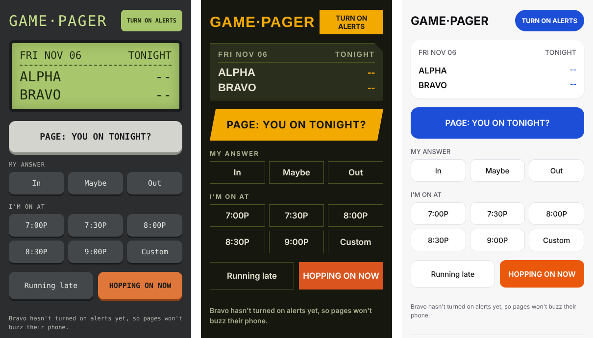

# Game Pager

A retro pager for two friends who game together. Ask "You on tonight?", answer In / Maybe / Out, pick the time you'll be on, post "running late" or "hopping on now", and your friend's phone buzzes.

- **Two people, no accounts.** Each of you types your own name and a shared pair code.
- **Real phone notifications** on Android (Chrome) and iPhone (added to the home screen).
- **Optional PUBG stats.** If you play PUBG on Steam, it can show last night's games, wins and kills each morning.
- **Free to run** on Cloudflare's free plan, with no credit card and no ads.
- **Three looks:** Retro pager, Military or Minimal, picked on each phone.



## This is self-hosted

**You run your own copy.** There's no central Game Pager server, no sign-up and no shared service. Following the steps below puts the app on **your own free Cloudflare account**, at your own address, like `https://game-pager.yourname.workers.dev`.

- Your pager, your data: names, statuses and alert subscriptions are stored only in your Cloudflare account.
- Nobody else, including the author of this project, can see or reach your pager.
- One person sets it up (about 15 minutes), then sends the link and pair code to their friend.

---

## What you need

- A computer (Mac, Windows or Linux) for the one-time setup.
- [Node.js](https://nodejs.org) **LTS** installed.
- A free [Cloudflare account](https://dash.cloudflare.com/sign-up).
- Optional: a free [PUBG API key](https://developer.pubg.com) if you want PUBG stats.

## Setup (one person, once)

> Want to try it before putting it online? See [Try it on your computer first](#try-it-on-your-computer-first).

### 1. Download the code
Either clone it:
```
git clone https://github.com/Neathx/game-pager.git
cd game-pager
```
or download **Source code (zip)** from the [latest release](https://github.com/Neathx/game-pager/releases/latest), unzip it, and open a terminal in that folder (it may be called `game-pager-1.0.0`).
- **Mac:** right-click the folder → **New Terminal at Folder**.
- **Windows:** right-click inside the folder → **Open in Terminal**.

### 2. Set your time zone
Open `wrangler.jsonc` and change `TIMEZONE` to yours, for example `America/Los_Angeles` or `Europe/London`. This makes "tonight" reset at 5 AM your time.

### 3. Install and log in
```
npm install
npx wrangler login
```
Click **Allow** in the browser window that opens.

> **`npm install` warns that install scripts were blocked?** Newer npm versions (12+) don't run them by default. Run `npm install-scripts approve esbuild workerd`, then `npm install` again.

> **Login page won't connect back?** Some browsers (often Firefox on Mac) can't hand the login back to the terminal. Copy the link from the terminal into Safari or Chrome instead, or use an API token. See [Troubleshooting](#troubleshooting).

### 4. Put it online
```
npm run deploy
```
The first time, Cloudflare may ask you to pick a `workers.dev` subdomain. When it finishes, it prints your app's address. That's the link you'll share with your friend.

### 5. Choose your pair code
```
npm run setup
```
- **Pair code:** make up your own (6–32 letters or numbers). You and your friend both type this into the app.
- **PUBG API key:** paste one if you want stats, or press Enter to skip.

These are saved as private secrets on your Cloudflare account, never in the code.

## On each phone

1. Open your pager's link.
   - **Android (Chrome):** menu (⋮) → **Install app** / **Add to Home screen**.
   - **iPhone (Safari):** Share → **Add to Home Screen**, then open it **from the home-screen icon**. iPhone only allows alerts from home-screen apps.
2. Type **your name** (any name you like, up to 16 characters) and the **pair code**, then tap **PAIR**.
3. Tap **TURN ON ALERTS** and allow notifications.
4. Open **Settings → Send me a test alert** to check your phone buzzes.

The first two names to pair become the pager's two people. Pairing a new phone later? Type the same name to sign back in to your spot.

### PUBG stats (optional)
If you added a PUBG key, each person enters their **exact Steam PUBG name** under **Settings → My PUBG name**. Every morning the pager checks the last 24 hours. If you played, both phones get a "Last session stats are in" alert. **Check stats now** runs it on demand.

---

## Everyday use

| Button | What your friend sees |
|---|---|
| **PAGE: You on tonight?** | "*Name* paged you — You on tonight?" |
| **In / Maybe / Out** | Your answer |
| **I'm on at …** | "I'm on at 8:30 PM" |
| **Running late** | "Running 15 min late (now ~8:45 PM)" |
| **Hopping on now** | "*Name* is hopping on NOW" |

## Changing things later

| To change… | Do this |
|---|---|
| Your name | In the app: **Settings → My name** |
| The look (Retro / Military / Minimal) | In the app: **Settings → Look** (each phone picks its own) |
| The pair code | `npx wrangler secret put PAIR_CODE`, then type the new code when asked. Phones using the old code are sent back to the pair screen. |
| Add or replace the PUBG key | `npx wrangler secret put PUBG_API_KEY` |
| Quick-pick times | Edit `TIMES` at the top of `public/app.js`, then `npm run deploy` |
| Start over with new people | In the app: **Settings → Reset pager** (clears both names and alerts) |
| Your own domain | Cloudflare dashboard → your worker → **Domains → Add Domain** |

After editing any file, run `npm run deploy` again.

> Run `npm run setup` again **only** if you want brand-new notification keys. It replaces them, so both phones have to turn alerts back on.

## Troubleshooting

- **"Server not set up"**: run `npm run setup`.
- **`npm install` says install scripts were blocked, or `wrangler` fails with an esbuild/workerd error**: npm 12+ blocks install scripts by default. Run `npm install-scripts approve esbuild workerd`, then `npm install` again.
- **`npx wrangler login` fails in the browser**: press Control+C and run `npx wrangler login --browser=false`. Then paste the printed link into a browser where you're signed in to Cloudflare. Or skip the browser entirely: create a token at **dash.cloudflare.com/profile/api-tokens → Create Token → Edit Cloudflare Workers**, then run `export CLOUDFLARE_API_TOKEN=your-token` (Mac/Linux) or `$env:CLOUDFLARE_API_TOKEN="your-token"` (Windows PowerShell) in the same terminal.
- **"This pager already has two people"**: type one of the names already on the pager, or use **Reset pager** from a paired phone.
- **No alerts on iPhone**: open the app from the home-screen icon, and check notifications are allowed for it in iPhone Settings.
- **"PUBG couldn't find…"**: the PUBG name must match exactly, including capital letters.
- **See what the server is doing**: `npx wrangler tail`.

## Try it on your computer first

You can run the whole pager on your own computer, with nothing uploaded to Cloudflare:

```
npm install
npm run setup:local
npm run dev
```

`setup:local` saves the pair code and notification keys to a `.dev.vars` file (never committed). Then open **http://localhost:8787**.

- **Two people on one computer:** open the link in two different browsers (or a normal and a private window) and pair with two names. Alerts show up as desktop notifications in Chrome, Edge and Firefox.
- **On real phones:** phones need an `https://` address for alerts. Leave `npm run dev` running, and in a second terminal run a free temporary Cloudflare tunnel (no account or domain needed):
  ```
  npx cloudflared tunnel --url http://localhost:8787
  ```
  (On a Mac you can also `brew install cloudflared` and run `cloudflared tunnel --url http://localhost:8787`.) It prints a `https://….trycloudflare.com` link. Open it on both phones and set up as in [On each phone](#on-each-phone). The link changes every time you restart the tunnel, so you'd re-add the app and turn alerts on again.
- **Test the morning stats check:** with a PUBG key in `.dev.vars`, open **http://localhost:8787/cdn-cgi/local/scheduled**.

Press Control+C to stop. When you're happy, go back to [Setup](#setup-one-person-once) step 4.

## How it works

- `public/`: the phone app (plain HTML/CSS/JS, installable as a home-screen app).
- `src/index.js`: a Cloudflare Worker plus one Durable Object that stores the pager's state.
- `src/webpush.js`: standard Web Push (VAPID) with no third-party push service or Firebase.
- `src/pubg.js`: optional stats from the official PUBG API.

Free-plan limits are far beyond what two people use.

## License

MIT. See [LICENSE](LICENSE). Not affiliated with PUBG, KRAFTON or Cloudflare.
